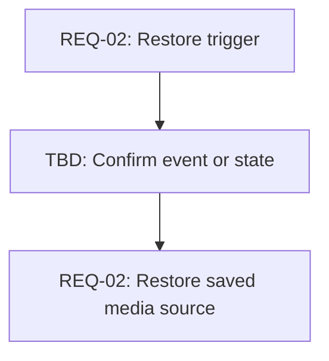
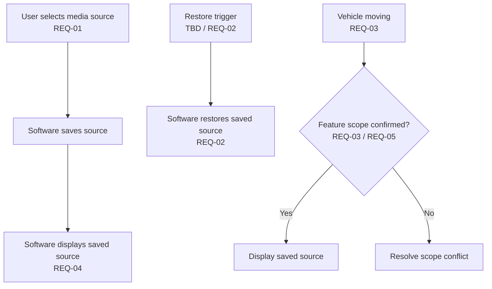

# Infotainment media source SRS

## Clarification and recommendations

Before finalizing this SRS, ask:

1. **Timing:** What maximum time, including its unit, is allowed instead of “quickly”? **Recommendation:** define a measurable upper limit, because otherwise the requirement cannot be made precise. You can accept this or provide a different timing rule.
2. **Restore condition:** What event or state does “when appropriate” refer to? **Recommendation:** identify one explicit trigger, such as ignition-on or a user request. You can choose another trigger or add a different condition.
3. **Scope:** Does display while moving belong to this parked-only feature? **Recommendation:** keep the parked-only constraint unless the feature owner explicitly adds a driving-state requirement. You can choose the moving behavior or provide a separate scope requirement.

The draft below keeps the affected items open until the user chooses an option or supplies additional requirements.

## Purpose and scope

This SRS covers saving, displaying, and restoring the selected media source. The supplied scope is parked-only. One requirement calls for display while moving, so the operating scope needs confirmation.

## System overview

The user selects a media source. The infotainment software saves and displays the selection and can later restore the saved source.

## Functional requirements

| ID | Requirement | Source sentence |
| --- | --- | --- |
| REQ-01 | When the user selects a media source, the infotainment software shall save the selected source. | “When the user selects a media source, the infotainment software shall save it.” |
| REQ-02 | The infotainment software shall restore the saved media source when appropriate. | “The infotainment software shall restore the saved media source when appropriate.” |
| REQ-03 | The infotainment software shall display the saved media source while the vehicle is moving. | “The infotainment software shall display the saved media source while the vehicle is moving.” |

## Non-functional and interface requirements

| ID | Requirement | Source sentence |
| --- | --- | --- |
| REQ-04 | After saving a media source on user selection, the infotainment software shall display the saved media source quickly. | “After saving a media source on user selection, the infotainment software shall display the saved media source quickly.” |

No interface requirements were supplied.

## Requirement quality review

| Requirement | Check | Finding | Linked issue |
| --- | --- | --- | --- |
| REQ-02 | Condition | “When appropriate” does not identify the restore trigger. | ISSUE-002 |
| REQ-03, REQ-05 | Consistency | Moving-state behavior conflicts with the parked-only constraint. | ISSUE-003 |
| REQ-04 | Measurable wording | “Quickly” has no maximum time or unit. | ISSUE-001 |

## Constraints and assumptions

| ID | Requirement | Source sentence |
| --- | --- | --- |
| REQ-05 | The feature shall apply only while the vehicle is parked. | “This feature applies only while the vehicle is parked.” |

No assumptions were supplied.

## Requirement flows

### Connected requirements: REQ-02

**Requirement:** The infotainment software shall restore the saved media source when appropriate.

**Flow:**

### Integrated requirement flow

**Requirements:**

- `REQ-01` — Save the selected media source.
- `REQ-02` — Restore the saved media source when appropriate.
- `REQ-03` — Display the saved media source while moving.
- `REQ-04` — Display the saved media source quickly after saving.
- `REQ-05` — Apply the feature only while parked.

REQ-01 and REQ-04 have a clear sequence. REQ-02, REQ-03, and REQ-05 remain in the same chart as open or conditional parts of the overall flow.

The restore trigger and the moving-vehicle scope are not defined by the source text, so the flow keeps them open.

## Issues and open items

### ISSUE-001 — Vague timing

- **Affected requirements:** `REQ-04`
- **Problem:** “Quickly” gives no measurable limit.
- **Resolution options:**
  - **A (recommended):** Define a maximum elapsed time and unit.
  - **B:** Remove the timing expectation.
  - **C:** Add a different timing rule.
- **Decision:** `Decision Needed`
- **Status:** `Decision Needed`

### ISSUE-002 — Missing restore condition

- **Affected requirements:** `REQ-02`
- **Problem:** “When appropriate” does not identify the restore trigger.
- **Resolution options:**
  - **A (recommended):** Define one explicit trigger, such as ignition-on or a user request.
  - **B:** Define multiple allowed triggers.
  - **C:** Add a different trigger.
- **Decision:** `Decision Needed`
- **Status:** `Decision Needed`

### ISSUE-003 — Scope conflict

- **Affected requirements:** `REQ-03`, `REQ-05`
- **Problem:** Display while moving conflicts with the parked-only constraint.
- **Resolution options:**
  - **A (recommended):** Keep the feature parked-only and remove or move `REQ-03`.
  - **B:** Expand the feature to include driving and revise `REQ-05`.
  - **C:** Add a separate driving-state requirement supplied by the user.
- **Decision:** `Decision Needed`
- **Status:** `Decision Needed`
