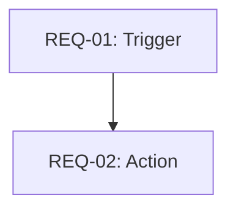
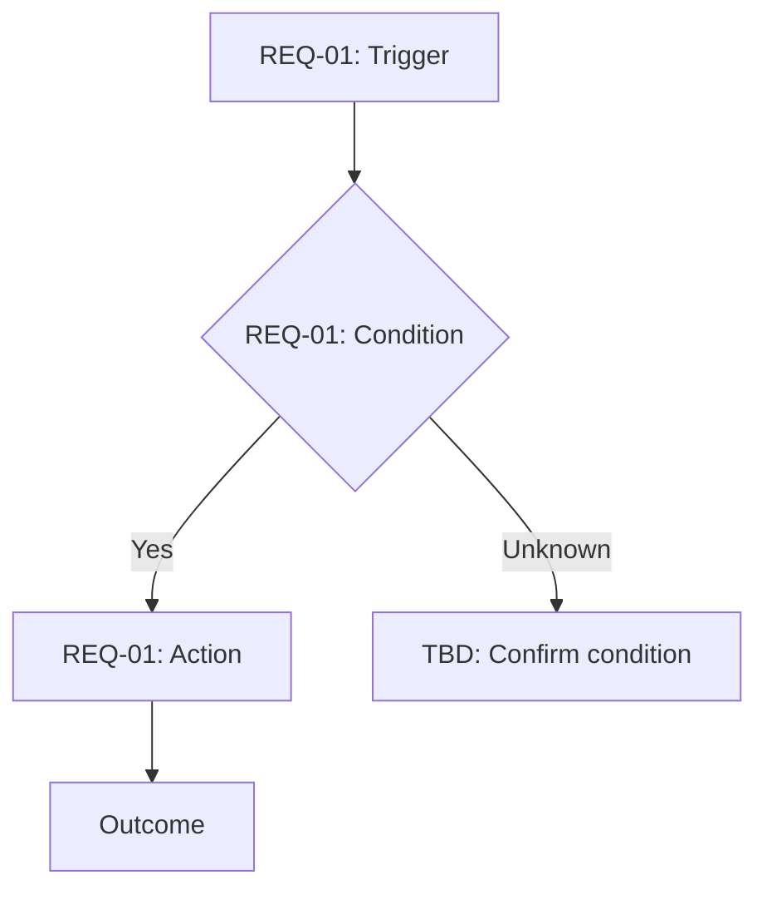
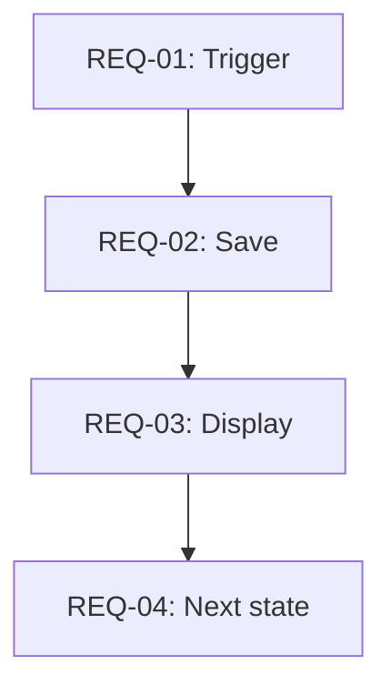

# Markdown SRS output format

Use these sections.

1. **Clarification and recommendations** — Before the SRS, list only the questions whose answers would change a requirement, scope, or flow. For each, give a recommended option and briefly state its impact. Let the user choose the recommendation or add a different requirement before finalizing the affected part.
2. **Purpose and scope** — Identify the software, the purpose of the SRS, and the supplied scope boundaries.
3. **System overview** — Summarize the actors and behavior described by the input.
4. **Functional requirements** — List what the software shall do.
5. **Non-functional and interface requirements** — List quality requirements, such as timing, and obligations at system boundaries.
6. **Requirement quality review** — Check each requirement for actor, trigger, condition, one clear obligation, measurable wording, consistent terminology, and consistency with related requirements. Show only failed or questionable checks.
7. **Requirement flows** — Keep the normal requirement sections in table format. In this section, list each applicable flow with the connected requirement IDs, a short description of those requirements, and its Mermaid chart. Finish with one **Integrated requirement flow** for requirements with clear dependencies or a shared sequence.
8. **Constraints and assumptions** — List required limits and note any supplied assumptions separately.
9. **Issues and open items** — For each unclear, conflicting, or incomplete requirement, give the affected IDs, the issue, practical resolution options, a recommended option, the user's decision, and the current status.

Use this table format for requirements, including required constraints.

| ID | Requirement | Source sentence |
| --- | --- | --- |
| REQ-01 | One obligation in clear language | “Original sentence, quoted verbatim.” |

If a section has no supplied content, say so briefly.

## Requirement quality review format

Use a compact table only for findings:

| Requirement | Check | Finding | Linked issue |
| --- | --- | --- | --- |
| REQ-04 | Measurable wording | “Quickly” has no limit or unit. | ISSUE-001 |

If all checks pass, write: `No quality issues identified from the supplied information.`

## Issue resolution format

Use this format instead of a question-only list:

### ISSUE-001 — Vague timing

- **Affected requirements:** `REQ-04`
- **Problem:** “Quickly” has no measurable limit.
- **Resolution options:**
  - **A (recommended):** Define a maximum elapsed time and unit.
  - **B:** Remove the timing expectation.
  - **C:** Add a user-provided timing rule.
- **Recommendation impact:** Option A makes the requirement precise and keeps it measurable; the exact value still needs the user's decision.
- **Decision:** `Decision Needed`
- **Status:** `Decision Needed`

When the user chooses or supplies a resolution, replace the decision with the selected wording, set the status to `Resolved`, and update every affected requirement and flow.

## Clarification behavior

- Ask questions before finalizing affected requirements when the missing answer changes behavior, scope, or flow.
- Phrase questions so the user can answer directly, for example: “Does this apply while parked, while driving, or both?”
- Offer a recommended option first, followed by the practical impact. The user may select it, choose another option, or provide an additional requirement in their own words.
- Treat additional user requirements as authoritative input and update the requirement, source note, affected flow nodes, and open items together.
- Keep the original wording visible. Do not turn the recommendation into a confirmed requirement until the user accepts it or supplies an equivalent requirement.
- If the user requests an immediate draft, continue with `TBD` and `Confirmation needed` labels.

## Mermaid flow format

For each applicable flow, use this compact structure:

### Connected requirements: REQ-01, REQ-02

**Requirements:**

- `REQ-01` — Short requirement description.
- `REQ-02` — Short requirement description.

**Flow:**

Keep the connected requirement IDs and descriptions directly above their chart. Simple requirements without meaningful steps do not need an individual flow.

### Individual requirement flow

Use this only when one requirement has multiple meaningful steps.

### Integrated requirement flow

Use this when multiple requirements have an explicit sequence or dependency.

Do not add branches, actors, states, or outcomes that are not supported by the supplied requirements, and do not combine unrelated requirements into one chart.
