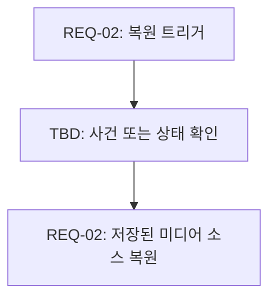
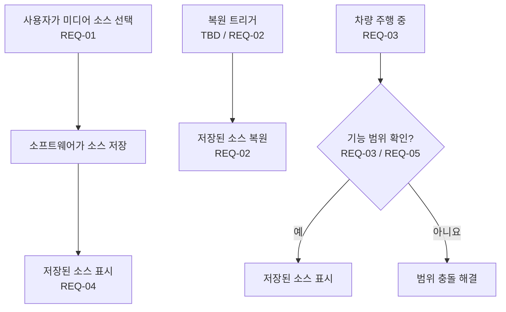

# 인포테인먼트 미디어 소스 SRS 예제

이 부분 예제는 확인 질문, 출처 정합성, 미결 결정을 보여주며 모듈의 최종 전달 문서는 아니다. 공통 참고 형식에 맞춘 전체 개발 예제는 [속도 신호 SRS](../examples/speed-signal/docs/modules/speed-signal/01-srs/SRS.md)를 참조한다.

## 확인 질문과 권고

SRS를 확정하기 전에 다음을 묻는다.

1. **시간:** “빠르게” 대신 허용되는 최대 시간과 단위는 무엇인가? **권고:** 측정 가능한 상한을 정한다. 그래야 요구사항을 정확히 쓸 수 있다. 다른 시간 규칙을 제시해도 된다.
2. **복원 조건:** “적절할 때”는 어떤 사건이나 상태인가? **권고:** 점화 켜짐이나 사용자 요청처럼 명시적인 트리거 하나를 정한다. 다른 조건을 추가할 수도 있다.
3. **범위:** 주차 전용 기능에 주행 중 표시도 포함하는가? **권고:** 기능 책임자가 명시적으로 주행 중 동작을 추가하지 않는 한 주차 전용 제한을 유지한다. 주행 동작을 선택하거나 별도 요구사항을 제시할 수 있다.

아래 초안은 사용자가 선택하거나 요구사항을 추가할 때까지 해당 사항을 미결로 둔다.

## 목적과 범위

이 SRS는 선택한 미디어 소스의 저장, 표시, 복원을 다룬다. 제공된 범위는 주차 중에 한정된다. 한 요구사항은 주행 중 표시를 요청하므로 동작 범위를 확인해야 한다.

## 시스템 개요

사용자가 미디어 소스를 선택한다. 인포테인먼트 소프트웨어는 선택값을 저장·표시하고 나중에 저장값을 복원할 수 있다.

## 기능 요구사항

| ID | 요구사항 | 원문 문장 |
| --- | --- | --- |
| REQ-01 | 사용자가 미디어 소스를 선택하면 인포테인먼트 소프트웨어는 선택한 소스를 저장해야 한다. | “사용자가 미디어 소스를 선택하면 인포테인먼트 소프트웨어는 선택한 소스를 저장해야 한다.” |
| REQ-02 | 인포테인먼트 소프트웨어는 적절할 때 저장된 미디어 소스를 복원해야 한다. | “인포테인먼트 소프트웨어는 적절할 때 저장된 미디어 소스를 복원해야 한다.” |
| REQ-03 | 차량이 주행 중일 때 인포테인먼트 소프트웨어는 저장된 미디어 소스를 표시해야 한다. | “차량이 주행 중일 때 인포테인먼트 소프트웨어는 저장된 미디어 소스를 표시해야 한다.” |

이 예시의 원문 문장은 한국어로 작성했다. 출처 추적을 위해 원문과 정리된 요구사항을 구분한다.

## 품질 및 인터페이스 요구사항

| ID | 요구사항 | 원문 문장 |
| --- | --- | --- |
| REQ-04 | 사용자 선택으로 미디어 소스를 저장한 뒤 인포테인먼트 소프트웨어는 저장한 소스를 빠르게 표시해야 한다. | “사용자 선택으로 미디어 소스를 저장한 뒤 인포테인먼트 소프트웨어는 저장한 소스를 빠르게 표시해야 한다.” |

인터페이스 요구사항은 제공되지 않았다.

## 요구사항 품질 검토

| 요구사항 | 검사 | 발견사항 | 연결된 이슈 |
| --- | --- | --- | --- |
| REQ-02 | 조건 | “적절할 때”는 복원 트리거를 특정하지 않는다. | ISSUE-002 |
| REQ-03, REQ-05 | 일관성 | 주행 중 동작이 주차 전용 제한과 충돌한다. | ISSUE-003 |
| REQ-04 | 측정 가능성 | “빠르게”에는 최대 시간과 단위가 없다. | ISSUE-001 |

## 제약과 가정

| ID | 요구사항 | 원문 문장 |
| --- | --- | --- |
| REQ-05 | 이 기능은 차량이 주차 중일 때에만 적용되어야 한다. | “이 기능은 차량이 주차 중일 때에만 적용되어야 한다.” |

제공된 가정은 없다.

## 요구사항 흐름

### 연결된 요구사항: REQ-02

**요구사항:** 인포테인먼트 소프트웨어는 적절할 때 저장된 미디어 소스를 복원해야 한다.

### 통합 요구사항 흐름

- `REQ-01` — 선택한 미디어 소스 저장
- `REQ-02` — 적절할 때 저장된 소스 복원
- `REQ-03` — 주행 중 저장된 소스 표시
- `REQ-04` — 저장 후 저장된 소스를 빠르게 표시
- `REQ-05` — 주차 중에만 기능 적용

REQ-01과 REQ-04에는 명확한 순서가 있다. REQ-02, REQ-03, REQ-05는 전체 흐름에서 아직 확인이 필요한 조건부 부분으로 남는다.

복원 트리거와 주행 중 범위는 원문에서 정해지지 않았으므로 흐름에서도 미결로 둔다.

## 이슈와 미결사항

### ISSUE-001 — 모호한 시간

- **영향받는 요구사항:** `REQ-04`
- **문제:** “빠르게”에는 측정 가능한 한계가 없다.
- **해결 옵션:** A(권고) 최대 경과 시간과 단위를 정의한다. B 시간 기대를 제거한다. C 사용자가 다른 시간 규칙을 제시한다.
- **결정·상태:** `Decision Needed`

### ISSUE-002 — 복원 조건 누락

- **영향받는 요구사항:** `REQ-02`
- **문제:** “적절할 때”는 복원 트리거를 특정하지 않는다.
- **해결 옵션:** A(권고) 점화 켜짐이나 사용자 요청처럼 명시적인 트리거를 정한다. B 허용되는 여러 트리거를 정한다. C 다른 트리거를 추가한다.
- **결정·상태:** `Decision Needed`

### ISSUE-003 — 범위 충돌

- **영향받는 요구사항:** `REQ-03`, `REQ-05`
- **문제:** 주행 중 표시가 주차 전용 제약과 충돌한다.
- **해결 옵션:** A(권고) 주차 전용을 유지하고 `REQ-03`을 제거하거나 다른 기능으로 옮긴다. B 주행까지 범위를 넓히고 `REQ-05`를 수정한다. C 사용자가 별도의 주행 중 요구사항을 제공한다.
- **결정·상태:** `Decision Needed`
